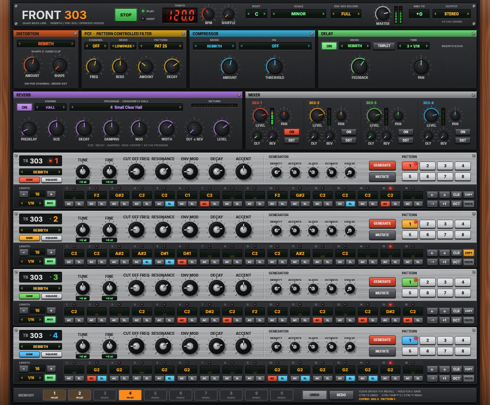
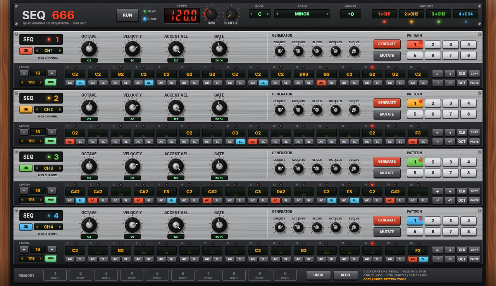

# Front 303



Demos: [effects and step rates](docs/demos/demo_effects.mp3) · [Open303 voice](docs/demos/compare_open303.mp3). Builds (VST3 + CLAP) in [releases/](releases/): Linux x86_64, Windows x86_64, macOS universal (Apple silicon and Intel). Manual (PDF): [English](releases/Front303-0.4.0-Manual-EN.pdf) · [Español](releases/Front303-0.4.0-Manual-ES.pdf).

Four TB-303 bass lines in one instrument. Each voice runs one of four models, chosen per voice:

| Model | What it is | Source |
|---|---|---|
| ReBirth | ReBirth RB-338's "2.0 sound" 303 | [OpenRB-338](https://github.com/pingw33n/OpenRB-338) |
| ReBirth Vintage | ReBirth RB-338's "Vintage" 303 | OpenRB-338 |
| DW-303 | A component-level model of the TB-303 circuit | [DW-303](https://github.com/mo0kid/DW-303) |
| Open303 | Robin Schmidt's Open303, compiled from its C++ | [open303 (maddanio)](https://github.com/maddanio/open303) |

The voices go through ReBirth's mixer and effects, as OpenRB-338 reimplements them: a distortion
switched per channel, a pattern-controlled filter (PCF) on one channel, a compressor on one
channel or on the master, and a tempo-synced delay fed by each channel's send. Front 303 adds
modes to them and a reverb:

| Effect | Modes | Source |
|---|---|---|
| Distortion | ReBirth; Setekh | [setekh](https://github.com/fullfxmedia/setekh), ported to Rust |
| Compressor | ReBirth; Valentine | [valentine](https://github.com/tote-bag-labs/valentine), ported to Rust |
| Delay | ReBirth; Tape; Intervals | [IV-XDelay](https://github.com/qbroquetas/IV-XDelay) ported to Rust with its measured tables; an interval delay after [Delay Intervals](https://github.com/Matth-ewe-f/audio-plugin-delay-intervals) |
| Reverb | Hall; Early reflections; Aether; Cloud | [Dragonfly](https://github.com/michaelwillis/dragonfly-reverb) (Hall and Early Reflections, on freeverb3), [Aether](https://github.com/Dougal-s/Aether), [CloudReverb](https://github.com/xunil-cloud/CloudReverb): their C++ compiled in |

Every voice has a tune control in semitones (±24), a fine control (±100 cents), its own step
rate under the shared tempo (1/32 to 1/4, triplets and dotted values included), and follows MIDI
notes as a transposition (C3 leaves it where it is) when its MIDI switch is on. The plugin has
a main stereo output and five auxiliary stereo outputs: one per voice and one for the effect
returns, used in the MULTI-OUT mode.

## SEQ 666



A second plugin from the same code: Front 303's four generative sequencers with **MIDI out and
no audio at all**. Each channel plays its own eight patterns on the MIDI channel chosen for it
(1–16), with its own octave, velocity, accent velocity and gate; slides go out as overlapping
(legato) notes. MIDI notes coming in transpose the channels that follow them. Ten memories as in
GenderBender P23 (click or key 1–0 recalls, hold 0.6 s saves), undo/redo, copy and paste of
patterns. Builds in [releases/](releases/) as `Seq666-0.1.0-*` (Linux, Windows, macOS; VST3 and
CLAP); user guide in Spanish: [SEQ666.es.md](SEQ666.es.md).

## Status

| Phase | Content | State |
|---|---|---|
| 1 | Engine: four voices, model per voice, tune and fine, mixer, effects, pattern playback | done |
| 2 | Sequencers: eight patterns per voice, random and generative 303 lines, mutation and evolution, quantisation to a root and one of 14 scales, shuffle | done |
| 3 | VST3 and CLAP plugin (nice-plug): host sync, 104 automatable parameters, patterns saved with the project, resampling to the host's rate | done |
| 4 | The panel: a rack in the manner of ReBirth 2.0, vector-drawn and resizable | done |
| 5 | 0.3.0: Open303, step rates per voice, MIDI transposition, separate outputs, Setekh, Valentine, tape and interval delays, reverb with four engines; 142 parameters | done |
| 6 | 0.4.0: ten memories (click or key 1–0 to recall, hold to save, saved with the project), undo/redo of everything done on the panel, copy and paste of patterns between voices and slots | done |

The user guide, in Spanish, is [MANUAL.es.md](MANUAL.es.md).

## Layout

- `crates/front303-core`: the engine. It knows nothing about plugins or windows.
  - `params.rs`: every setting, as plain data; `controls.rs`: the same settings as the flat
    list of controls the plugin's parameters and the panel are built from.
  - `pattern.rs`, `generator.rs`: patterns, the generator, mutation, quantisation.
  - `rb.rs`: the ReBirth voice, OpenRB-338's `Tb303` with Front 303's tuning.
  - `dw.rs`: the DW-303 voice, DW-303's circuit stages with the tuning added at the
    oscillator's control voltage.
  - `o3.rs`: the Open303 voice.
  - `fx/`: Setekh, Valentine, the tape echo, the interval delay, the reverb unit.
  - `engine.rs`: the transport (with a step rate per voice), host sync, MIDI transposition,
    the mixer block, the effects' routing and the outputs.
  - `shared.rs`: what the audio thread and the panel share without locks.
  - `snapshot.rs`: snapshots of the whole instrument, the ten memories and the undo history.
- `crates/front303-cxx`: the C++ engines (Open303, freeverb3 with Dragonfly's Hall and Early
  Reflections, Aether, CloudSeed) built with the `cc` crate from `third_party/`, behind a small
  C interface (`shim/`).
- `third_party/`: the vendored C++ sources and their licences, with Front 303's changes marked
  in the code (see NOTICE.md).
- `crates/front303-plugin`: the VST3/CLAP plugin (`lib.rs`), its parameters, the resampler and
  the panel (`gui/`). `--features standalone` builds the same panel and engine as a program.
- `crates/front303-cli`: `front303 demo DIR` renders demonstration WAVs.
- `crates/seq666`: SEQ 666, the MIDI-only plugin. It uses `front303-core` without its `engine`
  feature (no voices, effects or C++), its own control table (`controls.rs`), a sequencer that
  emits note events (`engine.rs`) and Front 303's panel pieces (`gui/`).

## Building

Rust 1.88 or later and a C++20 compiler (g++ 10+ or clang; zig's when cross-building). The
Rust engines come from their repositories at pinned revisions; the C++ ones are in
`third_party/`.

```sh
cargo test --release
# the plugin for this machine's glibc:
cargo build --release -p front303-plugin --lib
# or for glibc 2.31 and later, as released (needs zig and cargo-zigbuild):
cargo zigbuild --release -p front303-plugin --lib --target x86_64-unknown-linux-gnu.2.31
```

Windows and macOS are built by GitHub Actions (`.github/workflows/build.yml`): Windows
cross-compiled with MinGW-w64, macOS as a universal binary, both committed to `releases/`.

Then bundle `libfront303.so` as `Front303.vst3/Contents/x86_64-linux/Front303.so` (and copy it
as `Front303.clap`); `packaging/install.sh` installs a bundle for the current user.
`cargo build --release -p front303-plugin --features standalone --bin front303-standalone`
builds the standalone program.

SEQ 666: `cargo zigbuild --release -p seq666 --lib --target x86_64-unknown-linux-gnu.2.31`,
bundled as `Seq666.vst3/Contents/x86_64-linux/Seq666.so` (and `Seq666.clap`);
`packaging/seq666/` holds its installers and macOS bundle template.

## Checks

- `cargo test --release`: 51 tests of the engine, sequencer, step rates, MIDI transposition,
  outputs, every effect mode and reverb program, controls, memories, undo history and resampler, including that
  rendering never allocates — counted at `malloc`, so the C++ engines are covered too, through
  changes of mode, program and size.
- Steinberg's VST3 validator: 47 of 47 tests pass, also with nice-plug's
  `assert_process_allocs`.
- The panel was opened in the standalone program and embedded in Steinberg's editor host under
  Xvfb, and driven with simulated mouse input; the standalone played through JACK at 48 kHz,
  took MIDI notes from `jack_midiseq` and transposed, and gave the stems on its auxiliary
  ports in the MULTI-OUT mode.
- SEQ 666: 8 tests of note timing, gates, slides (legato overlap), MIDI channels, octave and
  velocities, step rates and shuffle, MIDI transposition, and that every note-on gets its
  note-off through stops, locates, pattern changes and channel changes; the VST3 validator
  passes 47 of 47; the panel and memories were driven under Xvfb.
- Not yet tried in REAPER, Bitwig or Ardour.

## What to know

- **44.1 kHz.** The engine always runs at 44.1 kHz in blocks of 64 samples, because ReBirth's
  tables and block-rate controls are built for that rate. The plugin resamples to the host's
  rate (32-tap Kaiser-windowed sinc, no added latency: the engine renders ahead instead).
- **The models do not share knob laws.** Pitch and loudness are matched across them.
- **The DW-303 voice's VCA decays** on long notes, as the circuit does.
- **Timing.** A ReBirth voice starts its notes on 64-sample block edges (1.45 ms), as the
  original does; a DW-303 voice starts them on the exact sample.
- **Cost.** A DW-303 voice cost about 20% of one core of the 2.1 GHz Xeon this was measured on;
  four of them nearly fill that core. The ReBirth voices cost almost nothing.
- **The distortion leaves a DC offset** on asymmetric waveforms, as ReBirth's does.
- **The tape echo** runs at 176.4 kHz (IV-X runs at 192 kHz; its head filters land 8 % lower)
  and its noise is synthesised: IV-X's recorded noise tables are not in its published source.
- **The reverb engines** are all built when the plugin is, and only the chosen one runs.
  freeverb3 resizes its delay lines on size and program changes; Front 303 serves those from a
  pool filled once at start-up, so they do not allocate on the audio thread.
- **Memories and undo** live in the panel: a memory holds every control (but RUN, OUTPUT and
  the DW-303 solver) and all 32 patterns; the undo history (100 steps) covers what is done on
  the panel, not host automation, and is not saved.

## License

GPL-3.0-only; see [LICENSE](LICENSE) and [NOTICE.md](NOTICE.md).
